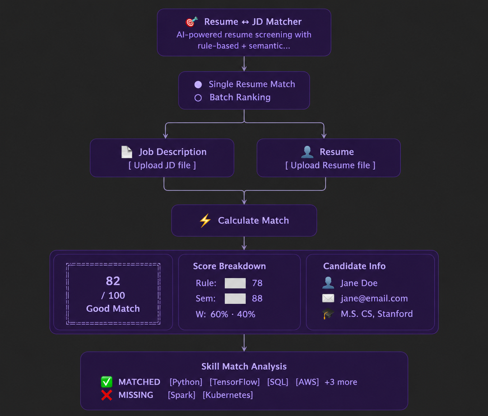
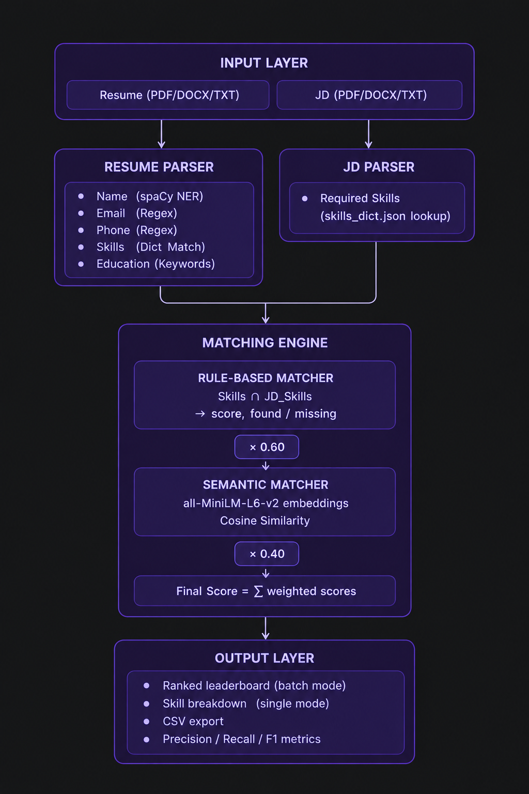

<div align="center">

# 🎯 Resume ↔ JD Matcher

### *AI-Powered Resume Screening — Hybrid Rule-Based + Semantic Matching*

[](https://python.org)
[](https://streamlit.io)
[](https://spacy.io)
[](https://huggingface.co/sentence-transformers/all-MiniLM-L6-v2)
[](LICENSE)

<br/>

> **Automatically rank candidates against a Job Description** using a sophisticated two-stage scoring engine — exact skill matching combined with neural semantic similarity — wrapped in a beautiful dark-mode Streamlit UI.

</div>

---

## ✨ Highlights at a Glance

| Feature | Description |
|---|---|
| 🧠 **Hybrid Scoring** | 60% rule-based (exact skills) + 40% semantic (contextual similarity) |
| 📄 **Multi-format Support** | Ingests **PDF**, **DOCX**, and **TXT** resumes & JDs |
| 👁️ **Explainable Results** | Every score comes with ✅ Found Skills and ❌ Missing Skills |
| 🏆 **Batch Ranking** | Upload dozens of resumes — get a ranked leaderboard in seconds |
| 🎨 **Premium Dark UI** | Glassmorphism cards, gradient scores, colour-coded badges |
| 📊 **Evaluation Suite** | Precision / Recall / F1 against manually-labelled ground truth |
| ⚖️ **Tunable Weights** | Sidebar slider lets recruiters tune rule vs. semantic balance live |
| ⬇️ **CSV Export** | Download the full ranked results table with one click |

---
## 🖼️ Interface Preview


## 🏗️ Architecture




---

## 📂 Project Structure

```
resume-jd-matcher/
│
├── 📁 src/
│   ├── 📁 extractors/
│   │   ├── text_utils.py       # PDF / DOCX / TXT text extraction
│   │   ├── resume_parser.py    # Name · Email · Phone · Skills · Education
│   │   └── jd_parser.py        # Required skills from JD text
│   │
│   ├── 📁 matchers/
│   │   ├── rule_based.py       # Exact keyword intersection scoring
│   │   └── semantic.py         # Sentence-transformer cosine similarity
│   │
│   ├── pipeline.py             # Orchestrates extract → match → rank
│   └── app.py                  # Streamlit UI (single & batch modes)
│
├── 📁 data/
│   ├── resumes/                # Drop your test resumes here
│   ├── jds/                    # Drop your test JDs here
│   ├── output/                 # Generated CSVs
│   └── skills_dict.json        # Canonical skills vocabulary
│
├── 📁 eval/
│   ├── generate_data.py        # Generate 20 synthetic Resume-JD pairs
│   ├── evaluate.py             # Run evaluation → Precision / Recall / F1
│   ├── labels.csv              # Ground-truth labels
│   └── eval_results.csv        # Detailed per-pair prediction results
│
├── 📁 docs/
│   └── REPORT.md               # Technical pipeline report
│
├── requirements.txt
└── README.md
```

---

## 🚀 Quick Start

### Prerequisites

- Python **3.9+**
- `pip` (or `conda`)

### 1 — Clone & enter the project

```bash
git clone https://github.com/your-username/resume-jd-matcher.git
cd resume-jd-matcher
```

### 2 — Create a virtual environment

```bash
python3 -m venv venv
source venv/bin/activate        # macOS / Linux
# venv\Scripts\activate         # Windows
```

### 3 — Install dependencies

```bash
pip install -r requirements.txt
```

### 4 — Download the spaCy language model

```bash
python -m spacy download en_core_web_sm
```

### 5 — Launch the app 🎉

```bash
streamlit run src/app.py
```

Open **http://localhost:8501** in your browser.

---

## 🎮 Using the App

### 🔍 Single Resume Match

1. Upload a **Job Description** (PDF / DOCX / TXT)
2. Upload a **Resume** (PDF / DOCX / TXT)
3. Click **⚡ Calculate Match**
4. View the final score, score breakdown, candidate info, and skill chips

### 📋 Batch Ranking (Multiple Resumes)

1. Upload a **Job Description**
2. Upload **multiple resumes** at once
3. Click **🚀 Rank N Resumes**
4. Get a colour-coded ranked leaderboard with summary metrics
5. Drill into per-candidate skill breakdowns via expandable rows
6. Click **⬇️ Download Full Rankings CSV** to export

### ⚙️ Tuning the Scoring Weights

Use the **sidebar slider** to adjust the balance between rule-based and semantic scoring:

| Mode | Rule-Based | Semantic | Best For |
|---|---|---|---|
| Strict Matching | 0.80 | 0.20 | Hard-skill roles (DevOps, DBA) |
| **Default** | **0.60** | **0.40** | **General use** |
| Contextual | 0.30 | 0.70 | Creative / leadership roles |

---

## 🧪 Evaluation Pipeline

Generate synthetic data and measure the pipeline's accuracy against ground-truth labels:

```bash
# Step 1 – Generate 20 labelled Resume-JD pairs
python eval/generate_data.py

# Step 2 – Run evaluation and print classification report
python eval/evaluate.py
```

**Sample output:**

```
Evaluation Results:

              precision    recall  f1-score   support

        Good       0.85      0.89      0.87         9
          OK       0.72      0.67      0.69         6
        Poor       0.90      0.90      0.90         5

    accuracy                           0.82        20
   macro avg       0.82      0.82      0.82        20
```

Detailed per-pair results are saved to `eval/eval_results.csv`.

---

## 🔬 How the Scoring Works

### Rule-Based Score (weight: 0.6)

```
Rule Score = |Resume Skills ∩ JD Required Skills| / |JD Required Skills| × 100
```

- **Fully interpretable** — exact "Found" and "Missing" skill lists returned
- Relies on `data/skills_dict.json` for canonical skill recognition
- Fast, deterministic, zero GPU required

### Semantic Score (weight: 0.4)

```
Semantic Score = cosine_similarity( embed(Resume), embed(JD) ) × 100
```

- Uses `all-MiniLM-L6-v2` (22M parameters) — fast, high-quality embeddings
- Captures **implicit context**: synonyms, adjacent skills, domain knowledge
- Compensates for vocabulary mismatches (e.g., *AWS* vs. *Amazon Web Services*)

### Final Score

```
Final Score = (Rule Score × 0.6) + (Semantic Score × 0.4)
```

| Score | Badge | Meaning |
|---|---|---|
| ≥ 60 | 🟢 **Good Match** | Strong candidate — proceed with interview |
| 30 – 59 | 🟡 **Partial Match** | Possible fit — review manually |
| < 30 | 🔴 **Poor Match** | Significant skill gaps |

---

## 📦 Dependencies

| Package | Version | Purpose |
|---|---|---|
| `spacy` | ≥ 3.7 | Named Entity Recognition (candidate names) |
| `sentence-transformers` | ≥ 2.3 | Neural semantic embeddings |
| `streamlit` | ≥ 1.30 | Interactive web UI |
| `PyPDF2` | ≥ 3.0 | PDF text extraction |
| `python-docx` | ≥ 1.1 | DOCX text extraction |
| `pandas` | ≥ 2.0 | Data manipulation & CSV export |
| `scikit-learn` | ≥ 1.3 | Evaluation metrics (P / R / F1) |
| `openpyxl` | ≥ 3.1 | Excel-format data support |

---

## ⚠️ Known Limitations

- **Dictionary dependency** — Skills outside `skills_dict.json` are not detected by the rule-based engine (niche frameworks, acronyms)
- **Full-text semantic embedding** — Boilerplate sections (hobbies, objective statements) dilute the semantic vector; section-segmented embedding would be more precise
- **Complex PDF layouts** — Multi-column PDFs may produce garbled text, reducing NER and regex accuracy
- **No skill priority tiers** — "Must-have" and "Nice-to-have" skills are currently weighted equally

---

## 🗺️ Roadmap

- [ ] **Synonym / alias mapping** in `skills_dict.json` (`"aws": ["amazon web services", "EC2"]`)
- [ ] **LLM-based skill extraction** — GPT / Gemini step to extract structured JSON skills directly from raw text
- [ ] **Section-aware semantic matching** — Embed Experience, Education, and Skills sections separately
- [ ] **Skill priority tiers** — Mandatory vs. preferred skill differentiation
- [ ] **REST API** — FastAPI wrapper for programmatic batch processing
- [ ] **Docker image** — One-command deployment
- [ ] **Database persistence** — Store job runs, compare candidates across sessions

---

## 🤝 Contributing

Contributions are welcome! Please:

1. Fork the repository
2. Create a feature branch: `git checkout -b feature/your-feature`
3. Commit your changes: `git commit -m 'feat: add synonym mapping'`
4. Push and open a Pull Request

---

## 📄 License

This project is licensed under the **MIT License** — see [LICENSE](LICENSE) for details.

---

<div align="center">

Built with ❤️ using **spaCy** · **sentence-transformers** · **Streamlit**

*Star ⭐ this repo if you found it useful!*

</div>
